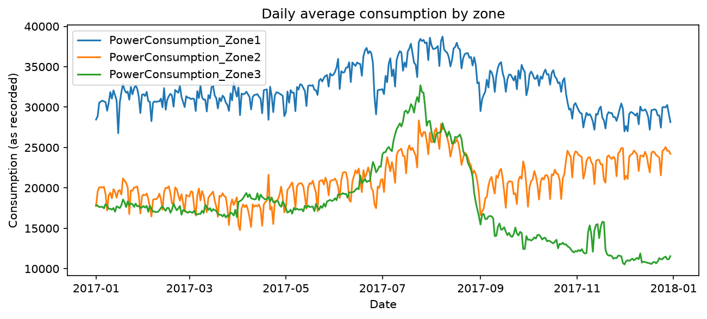
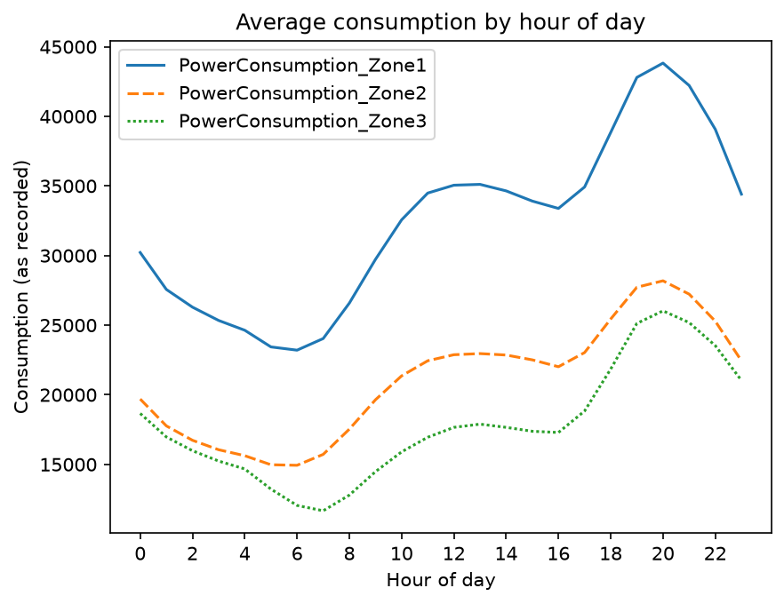
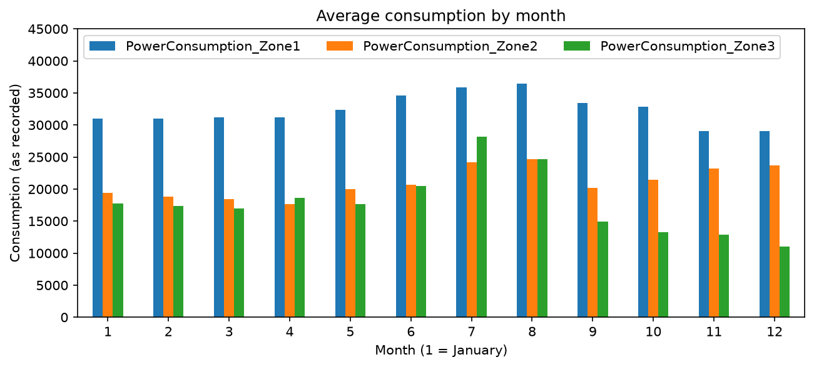
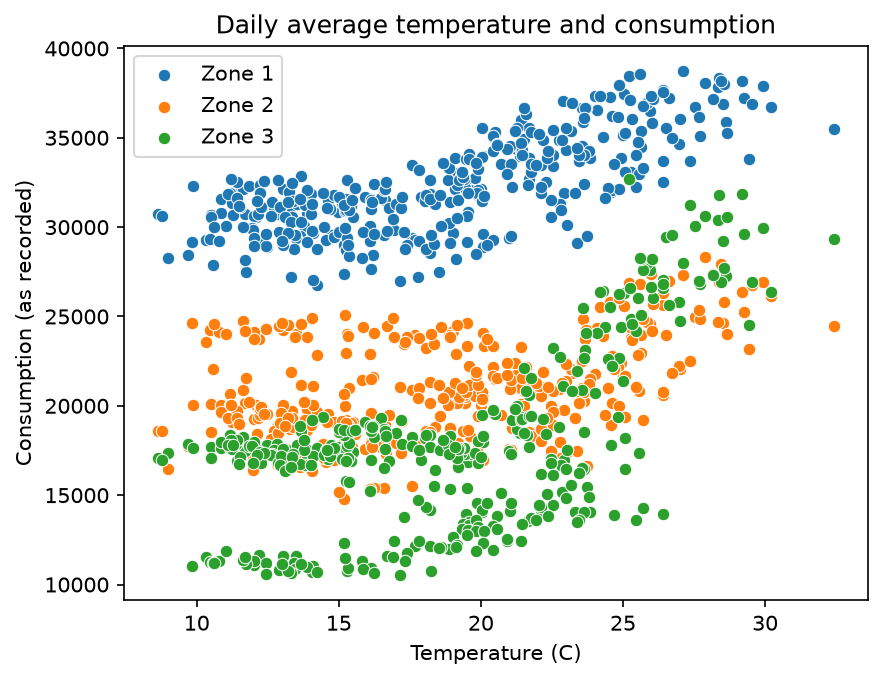

# Morocco Electricity Consumption Analysis

**AnalystLab Africa | Data Analytics Internship | Week 5: Exploratory Analysis and Interactive Visualisation of Morocco Electricity Consumption**

An exploratory analysis of 52,416 ten-minute electricity readings from three zones in Morocco (1 January to 30 December 2017), covering consumption patterns by hour, day and month, differences between the zones and the link with temperature, humidity and wind speed.

## Business problem

An energy management organisation in Morocco records electricity consumption every 10 minutes for three zones, together with environmental measurements. It needs more than raw records: how consumption changes over time, whether environmental conditions are associated with it, how the three zones differ and how history can support better energy planning.

## Dataset

- `powerconsumption.csv`: 52,416 readings and 9 columns (Datetime, Temperature, Humidity, WindSpeed, GeneralDiffuseFlows, DiffuseFlows and PowerConsumption for Zones 1 to 3)
- `powerconsumption_datadictionary.csv`: field descriptions

The raw datasets are not redistributed in this repository.

## Tools

Python, Jupyter Notebook, Pandas, NumPy, Matplotlib, Seaborn, Plotly

## Data preparation

- Converted `Datetime` from text to a date-time type using the explicit month/day/year format
- Checked missing values (none), duplicate rows (none), duplicate timestamps (none) and interval consistency (every gap exactly 10 minutes, no readings missing)
- Reviewed the data dictionary and noted three points that need care: the consumption unit, the diffuse flow columns and the wind speed values
- Investigated the extreme Zone 3 readings and kept them, because they form a genuine summer evening pattern.
- Added Year, Month, Day, Hour, Day_of_Week and Date columns and saved the result as `powerconsumption_cleaned.csv` (52,416 rows, 15 columns)

## Analysis approach

- Average, median, spread and relative variability for each zone
- Hourly, day-of-week and monthly averages, plus the highest and lowest consumption days
- Comparison of the three zones: share of combined consumption and how closely they move together
- Correlation with temperature, humidity and wind speed on raw readings, on daily averages, and after removing each hour's typical level
- Average consumption by temperature band and a closer look at the wind speed values
- Correlation is treated as association only, not as proof of cause.

## Notebook structure

`Morocco_Electricity_Consumption_Analysis.ipynb` is organised in six tasks:

1. Task 1: Dataset understanding and inspection, with a data-quality log
2. Task 2: Data cleaning and preparation
3. Task 3: Electricity consumption analysis
4. Task 4: Relationship with environmental factors
5. Task 5: Data visualisation (Matplotlib, Seaborn and Plotly)
6. Task 6: Business insights and recommendations.

## Chart preview






Interactive Plotly charts are saved as HTML files in the `charts` folder. Download one and open it in a browser. GitHub's notebook preview does not draw Plotly charts, so they only appear when you run the notebook.

## Key findings

1. Zone 1 has the highest average consumption (32,345, which is 45% of the combined average) and Zone 3 the lowest (17,835). Zone 3 is the most variable relative to its own level (0.37).
2. Consumption peaks at 8 PM in every zone and is lowest at 6 AM (Zones 1 and 2) or 7 AM (Zone 3). From 5 PM to 8 PM it rises by about 26%, 22% and 38% in Zones 1, 2 and 3.
3. July and August are the highest months. Zone 3 falls from 28,194 in July to 11,045 in December (about 2.5 times), while Zone 1 varies by only about 1.26 times.
4. The week is flat apart from a Sunday dip: about 12% below the average weekday in Zone 2 and about 6% below in Zone 1. Zone 3 shows no Sunday dip.
5. Temperature has the strongest link with consumption: 0.44, 0.38 and 0.49 on raw readings, 0.73, 0.42 and 0.61 on daily averages, and it stays positive (0.51, 0.33, 0.54) after the time of day is removed. This is association, not proof of cause.
6. Wind speed behaves like a two-state value (61% of readings near 0.08, 39% near 4.9) that is mostly high in July and August, so its link with consumption largely reflects the season. Zone 2 also rises in November and December, while Zones 1 and 3 fall.
7. Zone 3 has many extreme readings: 2,584 are above 30,000, all in June, July and August, and its ten highest readings come from four late-July days at about 8 PM. They form a genuine summer evening pattern and not sensor error, so they were kept. Zone 1 has no unusual values and Zone 2 only a few.

## Recommendations

1. Plan operations and capacity around the evening ramp: use the 8 PM average as the design point for each zone and schedule supply, reserves and any demand-response measures for the 5 PM to 10 PM window.
2. Build a separate summer plan for July and August, led by Zone 3, and test temperature forecasts as an input to short-term demand forecasts on more years of data before relying on them.
3. Schedule maintenance in the low-demand windows: the early-morning hours (about 3 AM to 7 AM) and, in Zones 1 and 2, Sundays.
4. Investigate Zone 3 and Zone 2 in the last quarter of the year (metering, network changes, customer mix) to explain why Zone 3 falls and Zone 2 rises.
5. Fix the data foundations: confirm the consumption unit with the data owner, correct the diffuse flow description, validate the wind sensor, and collect several years of data with holiday and calendar information.

## Assumptions and limitations

- The data dictionary gives the consumption unit as kWh, but the size of the values suggests average power. Values are reported as recorded and no absolute energy totals are given. Patterns, rankings and correlations are the same either way.
- The diffuse flow columns are described as emissions gases but follow a daylight cycle, so they are not used for conclusions.
- Humidity has no stated unit and is read as a percentage.
- Only one year (364 days) of data, so seasonal behaviour cannot be separated from one-off events.
- Correlation shows association, not cause: temperature moves together with the season and the time of day.

## How to reproduce

1. Install Python and the libraries: `pip install pandas numpy matplotlib seaborn plotly notebook`
2. Put `powerconsumption.csv` and `powerconsumption_datadictionary.csv` in the same folder as the notebook.
3. Open `Morocco_Electricity_Consumption_Analysis.ipynb` in Jupyter and choose **Run All**.
4. The notebook saves the charts to the `charts` folder and the cleaned data to `powerconsumption_cleaned.csv`.

## Folder contents

```text
Week5_Godfrey_Miracle/
├── README.md
├── Morocco_Electricity_Consumption_Analysis.ipynb
├── Morocco_Electricity_Consumption_Analysis_Report.pdf
├── powerconsumption_cleaned.csv
└── charts/
```

[Back to all projects](../README.md)

## Author

**Godfrey Miracle**
LinkedIn: https://www.linkedin.com/in/miracle-godfrey-815b60225/

GitHub: https://github.com/godfreymiracle-cmd

#AnalystLabAfrica